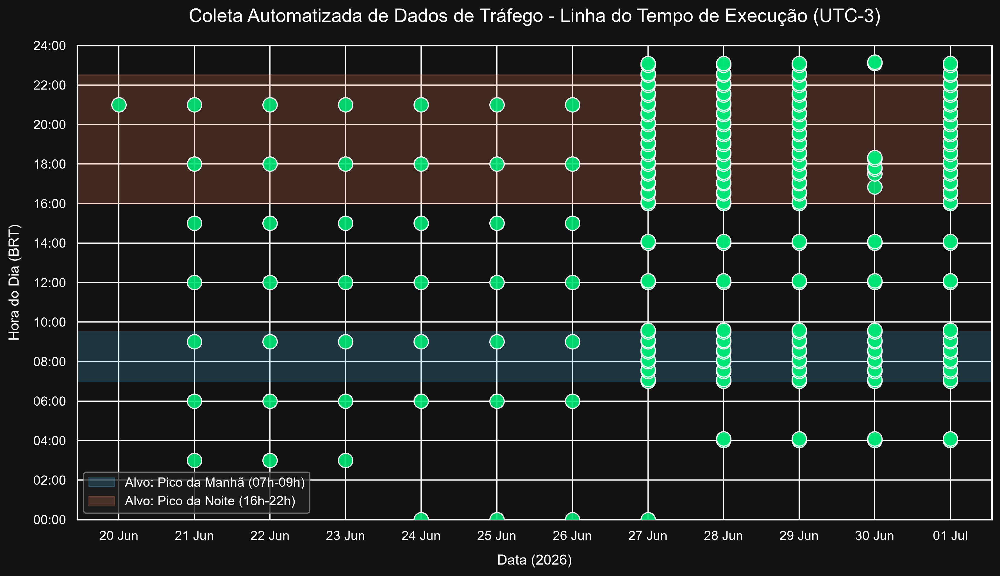
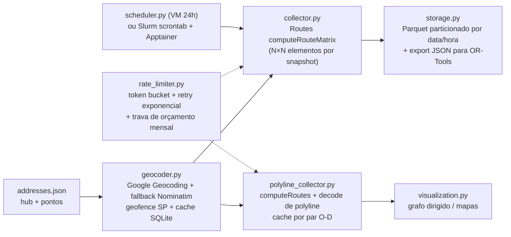

# Route Time Crawler: tempos de trajeto que variam com o trânsito

Este crawler roda **24 h por dia, durante semanas**, e monta com custo controlado um **dataset temporal** de distâncias e tempos de trajeto entre um hub de entregas e seus pontos de destino, a partir da Google Maps Routes API. O resultado mostra quanto a mesma viagem custa em cada horário e dia da semana, o dado que um modelo de ETA ou de roteamento dependente do horário precisa.

Ele foi desenvolvido no Instituto Eldorado como base de dados para modelos de roteamento (CVRP/VRPTW com GAT e Actor-Critic, e QAOA multiobjetivo). O objetivo era medir o custo de reabastecer uma rede de lojas na Grande São Paulo a partir de um hub fictício na Av. Rebouças. O projeto foi descontinuado e o código é publicado aqui com autorização.

> Os dados reais coletados no projeto **não** fazem parte deste repositório. O `config/addresses.json` traz apenas pontos fictícios de exemplo.

> Quer o grafo estático de uma cidade com rotas resolvidas no mapa? Isso está no projeto irmão, o [delivery-graph-builder](https://github.com/marcosreballo-source/delivery-graph-builder).

## Por que coletar continuamente

O tempo de trajeto entre dois pontos varia muito com o dia da semana, o horário e o trânsito. Quando o modelo de rotas recebe uma medição única, ele assume custo constante e gera rotas piores. Por isso o coletor tira snapshots da matriz origem-destino ao longo do dia, concentrados nos horários de pico.



*Execuções do crawler entre 20/06 e 01/07/2026. Na primeira fase, a coleta é espaçada a cada 3 h. Na segunda, ela se concentra nos picos da manhã e da noite.*

## Arquitetura



## Decisões de engenharia

- **Custo sob controle.** O `FieldMask` mantém cada chamada no SKU *Essentials* (US$ 5 por mil elementos). Pedir campos extras faz a chamada cair no SKU *Pro*, que custa o dobro. Um *ledger* de custo em SQLite bloqueia novas chamadas (`BudgetExceededError`) quando o gasto do mês atinge o orçamento configurado.
- **Menos chamadas.** Geocodificação e rotas físicas (polylines) ficam em cache, porque são estáveis. Só a matriz de tempos é recoletada.
- **Agendamento por janelas.** O scheduler cobre o pico da manhã (07:00–09:30), o pico da tarde (16:00–22:00) e horários esparsos ao longo do dia. Ele roda de dois jeitos:
  - como daemon local numa VM 24h (`src/scheduler.py`);
  - como `scrontab` num cluster Slurm com container Apptainer (`cluster/`).
- **Saídas prontas para otimização.** Os snapshots ficam em Parquet particionado, e as matrizes de distância e tempo saem no formato que o OR-Tools espera.

## Como rodar

```bash
pip install -r requirements.txt
export GOOGLE_MAPS_API_KEY=...        # ou um arquivo API_KEYS.txt (ignorado pelo git)
python run_collector.py --help
python -m src.scheduler               # daemon local de coleta agendada
```

No cluster: `apptainer build collector.sif cluster/collector.def` e depois `bash cluster/setup_scrontab.sh`.

## Projetos relacionados

- [delivery-graph-builder](https://github.com/marcosreballo-source/delivery-graph-builder): gera o grafo de entregas sobre a malha viária (OSRM) e resolve as rotas com OR-Tools. Foi a base das instâncias da frente de QAOA multiobjetivo ([arXiv:2610.00168](https://arxiv.org/abs/2610.00168)).
- O dataset temporal deste crawler alimentaria os modelos de roteamento com GNN do QGAT ([arXiv:2609.00489](https://arxiv.org/abs/2609.00489)). O código dos dois papers está em [quantum-routing-research](https://github.com/marcosreballo-source/quantum-routing-research).
